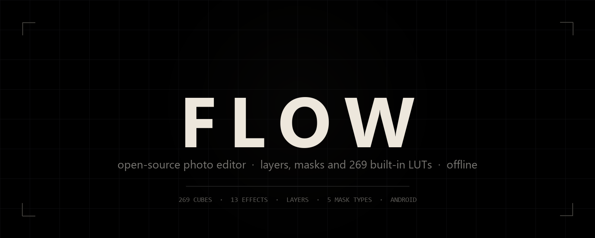
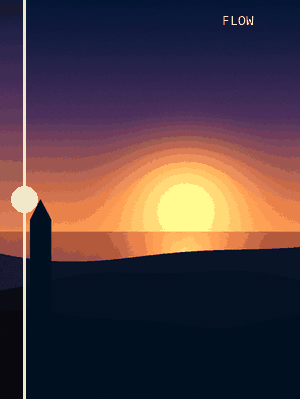
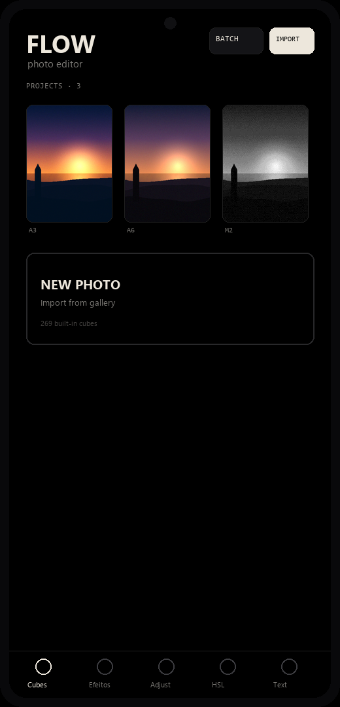
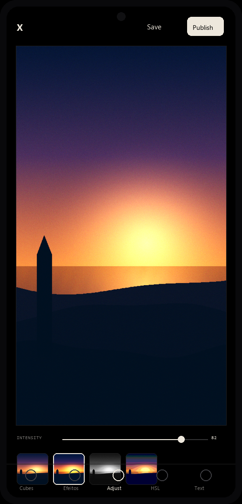
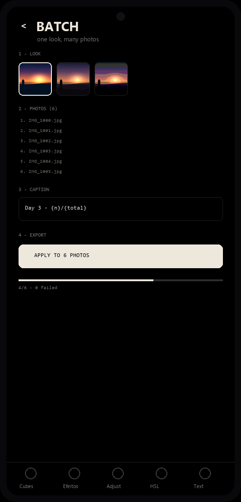
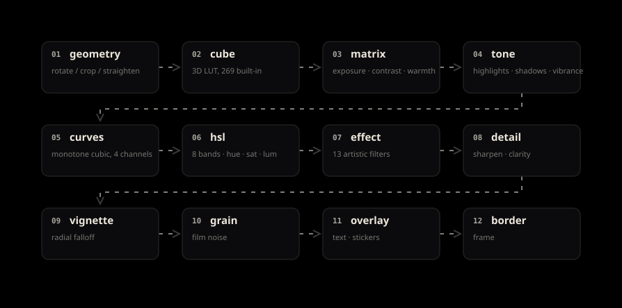
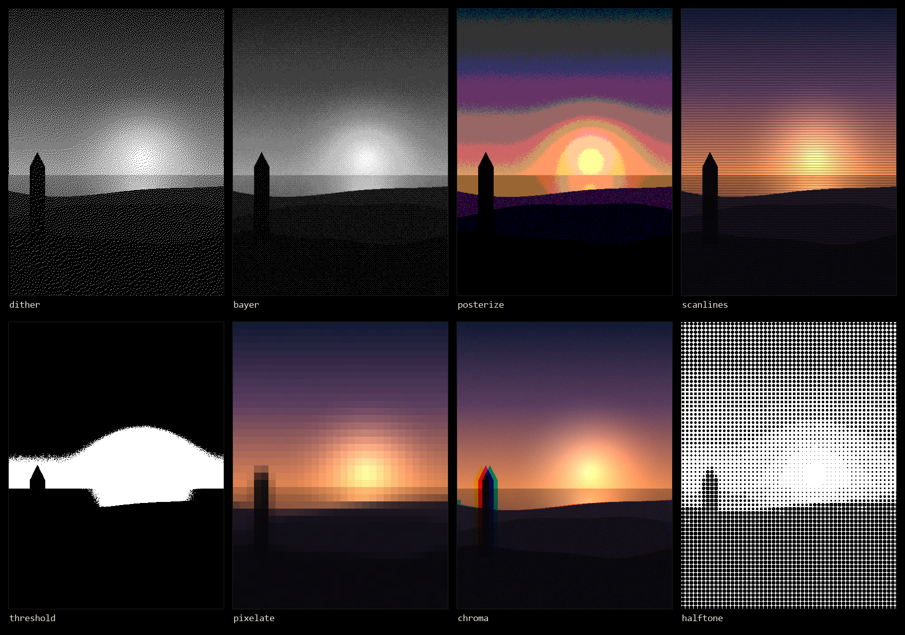

<div align="center">



<br>

**A free, open-source photo editor for Android.**

269 real 3D LUT cubes. Layer stack. Five mask types. No account, no cloud, no subscription.

<br>

[](https://developer.android.com)
[](https://kotlinlang.org)
[](https://developer.android.com/jetpack/compose)
[](LICENSE)

[](https://github.com/jaivedpereira/flow/releases)
[](#the-cube-pipeline)
[](#effects)
[](#privacy)

<br>



<sub><i>A synthetic test frame, straight → graded. One cube, one curve, one frame.</i></sub>

</div>

---

## Table of contents

<table>
<tr>
<td valign="top" width="50%">

**The app**
- [What it is](#what-it-is)
- [Screens](#screens)
- [Everything in the editor](#everything-in-the-editor)
- [Layers](#layers)
- [Masks](#masks)
- [Export](#export)

</td>
<td valign="top" width="50%">

**Under the hood**
- [The cube pipeline](#the-cube-pipeline)
- [Render pipeline](#render-pipeline)
- [Effects](#effects)
- [Real-time strategy](#real-time-strategy)
- [Performance notes](#performance-notes)
- [Build](#build)
- [Privacy](#privacy)

</td>
</tr>
</table>

---

## What it is

Flow is a photo editor that does one thing properly: applying a look, and giving
you the controls to bend that look into something of your own.

It is not a social network, not a subscription, and not a demo. There is no
account, no upload, no telemetry. Import a photo, edit it, save it back. The whole
app works in airplane mode because there is nothing for it to talk to.

**What it is not:** a RAW developer, a Photoshop replacement, or an AI editor.
There is no server, so nothing in Flow pretends to understand your photograph.

---

## Screens

<div align="center">





<sub><i>Library · Editor · Batch</i></sub>

</div>

### Library

Two tabs. **Início** is a landing page: one hero card that says what the app is
for, then your six most recent edits. **Minhas fotos** is the library proper.

```
Todas · Favoritas · Álbuns
Mais recentes ▾                          Selecionar
```

Photos are stored as **projects**, not as files in a list: each one holds the
photo copy plus every edit you made to it, so reopening a project three weeks
later shows the exact frame you left behind.

Albums reference projects rather than containing them, so one photo can sit in
several albums and deleting an album never touches a photo.

### About

Version is read from the package at runtime, never typed by hand, so it cannot
drift from the build you are actually running.

---

## Everything in the editor

Twelve tabs, in the order you would reach for them.

| Tab | What it holds |
|---|---|
| **Cubes** | 269 built-in LUTs plus `.cube` import and export |
| **Efeitos** | 13 artistic effects, plus spot removal |
| **Ajustes** | Exposure → blacks, dehaze, texture, noise, with live histogram and clipping warnings |
| **Curvas** | Master + RGB curves, monotone cubic, save your own sets |
| **HSL** | 8 colour bands × hue / saturation / luminance |
| **Texto** | Captions with custom fonts and drop shadows |
| **Adesivo** | Stickers, draggable on the canvas |
| **Camadas** | The layer stack |
| **Cortar** | Aspect, rotate, mirror, straighten, perspective |
| **Moldura** | Border width, colour, corner radius |
| **Receita** | Save a look, apply it to another photo, copy / paste |
| **Split** | Draggable before / after divider |

Plus, on every screen: **undo / redo** (coalesced, so a slider drag is one step),
**auto tone**, **hold to compare**, and **pinch to zoom**.

---

## Layers

A layer starts empty and you decide what it becomes.

```
Camadas ──────────────────────  [+ CAMADA]
  ● Texto "FLOW"        TEXT     ◉ 🔒  ↑ ↓  🗑
  ● Efeito Halation     EFFECT   ◉ 🔒  ↑ ↓  🗑
  ● Cubo Kodak          CUBE     ◉ 🔒     ↓  🗑
  ─────────────────────────────────────────────
  ● Foto                BASE
```

| Kind | What it applies |
|---|---|
| **Cubo** | A LUT, with its own intensity |
| **Cor** | A full manual grade |
| **Efeito** | Any of the 13 effects |
| **Texto** | A caption |
| **Adesivo** | A sticker |

Layers composite **bottom to top**, and the order is real: a caption under an
effect layer gets graded with the photo, one above it stays clean.

Selecting a layer makes the other tabs edit *that layer* instead of the base
photo. Nothing is ever silently redirected — with no layer selected, the tabs go
back to editing the base.

### Adjustments are not reorderable, and that is deliberate

Content layers (text, stickers) have a z-order you control. Adjustment layers run
in the pipeline's fixed order. Pretending you could drag a curve below a cube
would be a list that lies about what the renderer does, so the panel says so
instead.

---

## Masks

Five ways to say *where* an adjustment lands.

| Shape | Use |
|---|---|
| **Pincel** | Paint it by hand |
| **Linear** | Gradient from one edge |
| **Radial** | Spotlight |
| **Luminância** | Only the bright or only the dark pixels |
| **Cor** | Only hues near a target |

Range masks (luminance and colour) are the useful ones: *vignette only in the
shadows*, *saturate only the greens*.

Masks can be mixed **additively** — a new gradient added to what you already
painted instead of replacing it.

---

## Export

```
FORMATO     JPEG · PNG · WebP
TAMANHO     Original · 3000 · 2048 · 1080 px
QUALIDADE   70 → 100
```

The output size and an estimated file size are shown live, so the choice has a
cost attached instead of being abstract. PNG is lossless, so the quality slider
hides itself rather than offering a control with no effect.

Exporting shows a blocking progress overlay with three honest stages —
**preparing**, **rendering**, **writing** — placed at the real boundaries in the
code, not on a timer.

---

## The cube pipeline

A 3D LUT is a cube of colour: sample a coordinate, get the graded colour back.
Flow ships **269 of them**.

```
luts.bin  7.57 MB  ·  269 cubes  ·  17³ = 4,913 entries each
```

Stored interleaved as `u16` RGB, 29,478 bytes per cube, with a `FLOWLUT1` header.
Interleaving matters: the sampler walks R, G, B for one entry, so keeping them
adjacent means one cache line instead of three.

Sampling is **trilinear** — the eight corners of the enclosing cell, weighted by
distance. Nearest-neighbour would band on gradients; trilinear is the difference
between a gradient and a staircase.

The whole table loads once into a `ByteBuffer` and is sampled directly, so
applying a cube costs one pass and no allocation per frame.

---

## Render pipeline

Twelve stages, in a fixed order. Every one is a real pixel operation.

```
geometry  →  cube  →  colour matrix  →  tone  →  curves  →  HSL
          →  effects  →  detail  →  [layers]  →  vignette  →  grain
          →  overlays  →  border
```



**Why this order.** Curves run after the colour matrix because they operate on
tone that already has the right white balance. HSL runs after curves so a
saturation push does not shift the hue you just set. Detail runs last in the
look stages because sharpening amplifies whatever noise the earlier stages
produced — cleaning before sharpening is the only order that makes sense.

---

## Effects

Thirteen, and each one is an algorithm rather than a preset.

<table>
<tr><td valign="top" width="50%">

**Ascii** — luminance to a character ramp
**Dither** — Floyd–Steinberg error diffusion
**Bayer** — ordered 4×4 dithering
**Halftone** — rotated dot screen
**Pixelate** — block averaging
**Posterize** — quantised levels
**CRT** — scanlines with phosphor falloff

</td><td valign="top" width="50%">

**Chroma** — per-channel radial shift
**Halation** — red-halo bloom off highlights
**Bloom** — threshold bloom
**Noise** — colour grain
**Datamosh** — block displacement
**Threshold** — hard luminance cut

</td></tr>
</table>



---

## Real-time strategy

The pipeline is split into two passes, because they have different costs and
different triggers.

| Pass | Contents | Runs when |
|---|---|---|
| **Expensive** | geometry, cube, matrix, tone, curves, HSL, effects, detail, adjustment layers | the look changes |
| **Cheap tail** | vignette, grain, content layers, border | every slider tick |

Dragging grain or vignette no longer rebuilds the frame. Dragging exposure does,
which is unavoidable — but it now runs on a half-resolution copy while the finger
is moving, and the full frame lands when it stops.

Both passes are driven by a **conflated channel** rather than the effect's own
lifecycle. A `LaunchedEffect` restarted on every value change cancels the render
in flight, which is exactly why an earlier build only updated the preview when
you released the slider.

---

## Performance notes

Things that were wrong and are now not:

- **Sharpening held four full-frame buffers.** On a 3000 px export that is ~280 MB
  and it killed the process. Detail is capped at 2 MP and the buffers are released
  between passes.
- **The detail stage discarded its own result.** It built a new bitmap, then
  recycled the old one while the pipeline still held a reference, so the next
  stage called `getPixels()` on a dead bitmap:
  `IllegalStateException: Can't call getPixels() on a recycled bitmap`. One missing
  assignment.
- **Grain multiplied the frame toward black.** Blending a mid-grey tile with
  `PorterDuff.MULTIPLY` multiplies against the tile's own alpha. It is a CPU pass
  now.
- **Spots and layers were not in the render keys**, so changing either updated the
  state and never redrew. The preview looked frozen.

Each of these was found by running the app on a device, not by reading the code.

---

## Build

Requires JDK 21 and the Android SDK with `compileSdk 37`.

```bash
git clone https://github.com/jaivedpereira/flow.git
cd flow
./gradlew :app:assembleRelease
```

The APK lands in `app/build/outputs/apk/release/`.

**No API keys, no `google-services.json`, no `.env`.** Nothing is configured per
machine, which is why the repo builds from a clean clone.

### Regenerating the LUTs

```bash
python tools/extract_luts.py    # source cubes → assets/luts.bin
python tools/pack_luts.py
python tools/make_icon.py       # launcher icon
python tools/make_readme_assets.py
```

### Validators

Each pipeline stage has a validator that compares the Kotlin implementation
against a NumPy reference:

```bash
python tools/validate_presets.py
python tools/validate_effects.py
python tools/validate_curves.py
python tools/validate_hsl.py
python tools/validate_masks_cubes.py
```

---

## Privacy

The app does not request the `INTERNET` permission. That is a hard boundary, not a
policy: there is no code path that could send anything anywhere, because the
permission is not in the manifest.

Imported photos are copied into the app's private storage. The original in your
gallery is never modified. Deleting a project deletes the copy, not the original.

---

## Tech

| | |
|---|---|
| Language | Kotlin 2.4 |
| UI | Jetpack Compose, Material 3 |
| Build | Gradle 9.7, AGP 9.4 |
| minSdk · targetSdk | 26 · 36 |
| Source | 48 Kotlin files, ~13,100 lines |
| Dependencies | Compose, KotlinX Coroutines, `org.json` |

The render runs on the CPU by choice. It behaves identically on every device and
does not depend on a driver, a GPU generation, or a vendor's OpenGL quirks — at
the cost of needing downscaling on very large exports.

---

## Contributing

Issues and pull requests are welcome. There is no CLA and no template to fill in.

Before sending a change to the pipeline, run the matching validator — a stage that
drifts from its NumPy reference silently is the easiest kind of bug to ship.

---

<div align="center">
<sub>

**GPL v3** · built by [jaivedpereira](https://github.com/jaivedpereira)

No account. No cloud. No subscription.

</sub>
</div>
