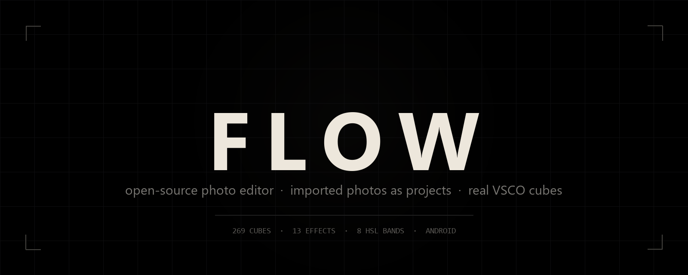
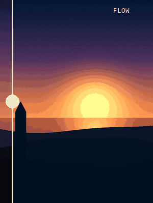
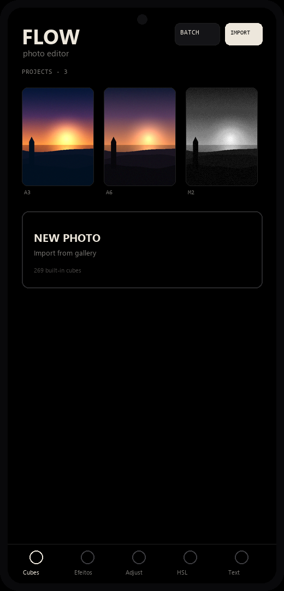
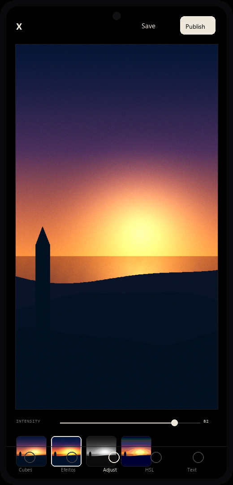
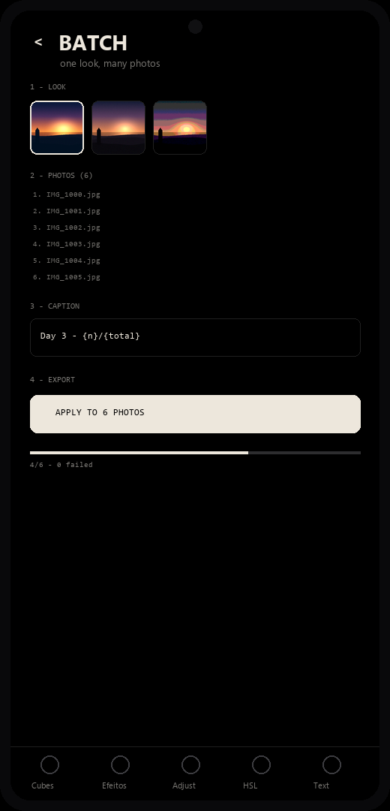
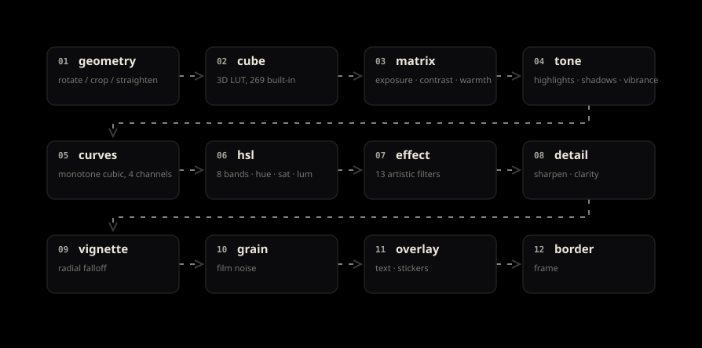
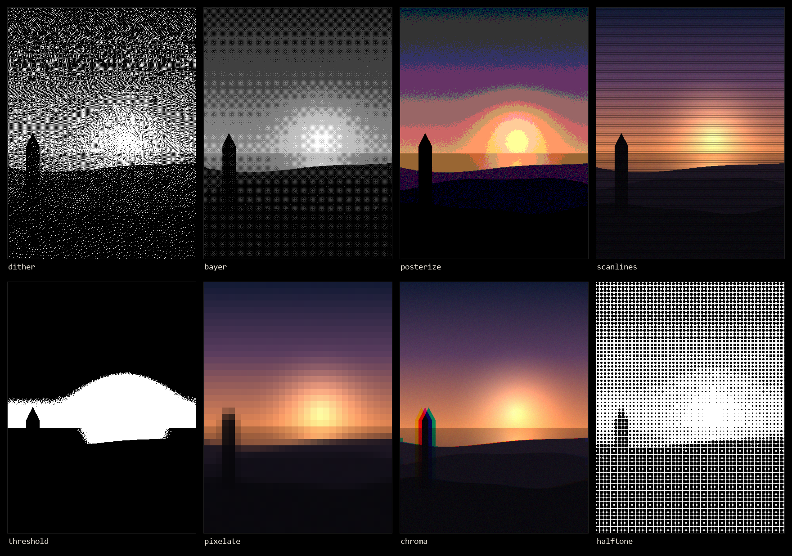
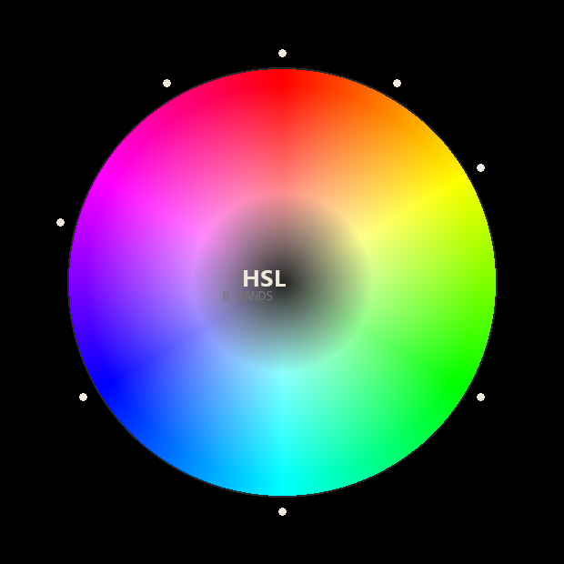

<div align="center">



<br>

**A free, open-source photo editor for Android.**
Real VSCO cubes. GrainRad-style effects. No account, no cloud, no subscription.

<br>

[](https://developer.android.com)
[](https://kotlinlang.org)
[](https://developer.android.com/jetpack/compose)
[](LICENSE)

[](https://github.com/jaivedpereira/flow/releases)
[](#the-cube-pipeline)
[](#effects)
[](#privacy)

<br>



<sub><i>A synthetic test frame, straight → graded. One cube, one curve, one frame.</i></sub>

</div>

---

## Table of contents

<table>
<tr>
<td valign="top" width="50%">

**The app**
- [What it is](#what-it-is)
- [Screens](#screens)
- [The pipeline](#the-pipeline)
- [Cubes](#the-cube-pipeline)
- [Effects](#effects)
- [Colour](#colour)
- [Masking](#masking)
- [Text & stickers](#text--stickers)
- [Batch](#batch)
- [Privacy](#privacy)

</td>
<td valign="top" width="50%">

**The project**
- [Install](#install)
- [Build from source](#build-from-source)
- [Architecture](#architecture)
- [Code map](#code-map)
- [How the LUTs were made](#how-the-luts-were-made)
- [Roadmap](#roadmap)
- [Contributing](#contributing)
- [License](#license)

</td>
</tr>
</table>

---

## What it is

Flow is a photo editor built around one idea: **the good stuff should not be behind a
subscription.** It is a complete reimplementation of the editing model that makes
apps like VSCO feel good — presets you can browse as live thumbnails, a one-slider
intensity control, tone curves, selective colour — with the parts that app hides
behind a paywall left open.

It also takes the effects from [GrainRad](https://grainrad.com) (ASCII, dithering,
halftone, CRT, halation) and makes them *non-destructive*, adjustable, and
maskable — which the web tool cannot do because it processes a single frame.

Everything runs on-device. There is no network permission in the manifest at all.

<div align="center">
<table>
<tr>
<td align="center"><b>269</b><br><sub>3D LUT cubes</sub></td>
<td align="center"><b>13</b><br><sub>effects</sub></td>
<td align="center"><b>8</b><br><sub>HSL bands</sub></td>
<td align="center"><b>12</b><br><sub>pipeline stages</sub></td>
<td align="center"><b>0</b><br><sub>network calls</sub></td>
</tr>
</table>
</div>

---

## Screens

<table>
<tr>
<td align="center" width="33%">
<br>
<b>Projects</b><br>
<sub>Imported photos become projects.<br>Every tile is your own photo,<br>re-rendered with its cube.</sub>
</td>
<td align="center" width="33%">
<br>
<b>Editor</b><br>
<sub>12 modes. Live cube thumbnails,<br>real-time intensity,<br>press-and-hold to compare.</sub>
</td>
<td align="center" width="33%">
<br>
<b>Batch</b><br>
<sub>One look, 30 photos.<br>Captions with <code>{n}</code> and <code>{total}</code><br>resolved per file.</sub>
</td>
</tr>
</table>

---

## The pipeline

Every frame goes through the same twelve stages, in this order. Each stage is
skippable — if it is a no-op the bitmap is passed through by reference, never copied.

<div align="center">

</div>

Two details make this fast enough to feel live:

**Split render.** The expensive stages run once, at full strength, into a cached
`lookStage`. The intensity slider then performs a single cross-fade:

```kotlin
displayed = blended(original, lookStage, intensity)
```

Sliding intensity costs ~15 ms per frame instead of the ~150 ms a full re-render
takes. This is the entire reason the app feels responsive rather than laggy.

**Luma-preserving HSL.** HSV keeps value constant, so naively desaturating a vivid
red makes it *paler and brighter*. Flow rescales to the original luma before
applying the requested luminance change, so a band edit reads as "less red" rather
than "washed out".

---

## The cube pipeline

The 269 presets are **real 3D LUTs**, not colour matrices with a nice name.

<details>
<summary><b>How a VSCO <code>.xray</code> cube becomes a Flow preset</b></summary>

<br>

A `.xray` file is a container, not an image:

```
AES-128-CBC / PKCS7  →  zlib inflate  →  header + N × 17³ LUTs
```

Each LUT is **4913 entries of interleaved little-endian `u16` RGB** — 29 478 bytes,
exactly `17³ × 3 × 2`. Decrypt, inflate, slice, then pack all of them into a single
`luts.bin` with a small header:

```
magic "FLOWLUT1"
per cube: u16 key_len, u16 name_len, u16 group_len, strings..., u32 data_len
```

The app memory-maps that file and keeps an `LruCache<String, Lut>(6)`, so scrolling
the carousel never holds more than six cubes at once.

**Verification that the decryption was actually correct** — two independent checks
on the decoded data:

| cube | expectation | observed |
|---|---|---|
| `exposure` | neutral — R=G=B on the diagonal | ✅ exactly identical |
| `b1` | monochrome, red→0.09 / green→0.4 / blue→0.2 (Rec.601 luma weights) | ✅ exact |

If the key, the IV, the byte order or the entry stride had been wrong, those two
would not hold simultaneously.

</details>

<details>
<summary><b>Import and export <code>.cube</code></b></summary>

<br>

Flow reads and writes the standard Resolve `.cube` format, so a look is portable
in both directions.

**Import** accepts any `LUT_3D_SIZE` (17³, 33³, 64³), `TITLE`, `DOMAIN_MIN` /
`DOMAIN_MAX` (rescaled to 0..1 automatically), and `#` comments. `LUT_1D_SIZE` is
rejected with a clear message rather than producing subtly wrong output.

**Export** writes 6-decimal floats. One non-obvious detail cost a real bug:

```kotlin
// WRONG on a pt-BR phone — writes "0,123456", unparseable everywhere else
out.write("%.6f %.6f %.6f\n".format(r, g, b))

// RIGHT — the file format is locale-independent
out.write(String.format(Locale.US, "%.6f %.6f %.6f\n", r, g, b))
```

The parser now also tolerates comma decimals, so files written by the buggy build
can still be read back.

</details>

---

## Effects

Thirteen effects, ported from GrainRad's WebGPU shaders to plain Kotlin bitmap math.
All of them are **non-destructive**: they render at full strength and are then
blended by intensity, which is what makes the slider feel instant.

<div align="center">

<sub><i>Every tile is a real render of the validated algorithm, applied to a procedurally generated frame.</i></sub>
</div>

<table>
<tr><th align="left">Effect</th><th align="left">Algorithm</th><th align="left">Parameter</th></tr>
<tr><td><b>ASCII</b></td><td>luminance → glyph ramp <code>.:-=+*#%@</code></td><td>density</td></tr>
<tr><td><b>Dither</b></td><td>Floyd–Steinberg error diffusion</td><td>threshold</td></tr>
<tr><td><b>Bayer</b></td><td>ordered 8×8 dither matrix</td><td>levels</td></tr>
<tr><td><b>Halftone</b></td><td>dot radius from local luminance</td><td>cell size</td></tr>
<tr><td><b>Pixelate</b></td><td>downsample + nearest</td><td>block</td></tr>
<tr><td><b>Posterize</b></td><td>per-channel quantisation</td><td>levels</td></tr>
<tr><td><b>CRT</b></td><td>periodic scanline darkening</td><td>spacing</td></tr>
<tr><td><b>Chroma</b></td><td>opposed R/B channel shift</td><td>shift</td></tr>
<tr><td><b>Halation</b></td><td>blur of highlights + warm gain</td><td>glow</td></tr>
<tr><td><b>Bloom</b></td><td>blur + screen blend</td><td>radius</td></tr>
<tr><td><b>Noise</b></td><td>per-channel gaussian</td><td>amount</td></tr>
<tr><td><b>Datamosh</b></td><td>block displacement</td><td>block</td></tr>
<tr><td><b>Threshold</b></td><td>hard luminance cut</td><td>cut</td></tr>
</table>

<details>
<summary><b>Validation — what was actually checked</b></summary>

<br>

Each algorithm was ported to numpy and compared against expectation before the
Kotlin was trusted. Standard deviation and unique-value count prove the effect
is doing real work rather than returning a flat frame:

```
dither       std=123.7  unique=2    → pure black and white
bayer        std= 51.0  unique=5    → 5 ordered levels
posterize    std= 54.4  unique=6    → quantised
halftone     std= 86.3  unique=2    → dots on white
pixelate     std= 41.8  unique=118  → real blocks
```

</details>

---

## Colour

<div align="center">

</div>

**Selective HSL** — eight bands (`RED · ORANGE · YELLOW · GREEN · CYAN · BLUE ·
PURPLE · MAGENTA`), each with independent hue, saturation and luminance. Pixels are
weighted by **angular distance** to the band centre with a cosine falloff over a 45°
half-width, so bands blend at the edges instead of banding. Achromatic pixels are
skipped entirely — you can push every slider to the limit and a grey wall will not move.

**Curves** — four channels (RGB master + R/G/B), edited by dragging control points.
Interpolation is **Fritsch–Carlson monotone cubic**, not plain cubic spline: a
regular cubic overshoots between control points, and overshoot in a tone curve is
banding in skin tones. The monotone variant mathematically cannot go backwards.

Eight curve presets ship built-in (`Neutral`, `Film S`, `Lifted Black`, `Faded White`,
`Punch`, `Cool Shadows`, `Warm Highlights`, `Matte`), and you can save your own.

<details>
<summary><b>Curve validation</b></summary>

<br>

```
identity     start=  0 mid=128 end=255  monotonic ✓
S-contrast   start=  0 mid=131 end=255  monotonic ✓
lift         start= 30 mid=143 end=255  monotonic ✓
fade         start= 20 mid=127 end=234  monotonic ✓
```

And the HSL isolation test on a real photo — only the red band moved,
29% of pixels stayed bit-identical:

```
[7] isolation on a real image
    pixels changed: 71.0%   pixels untouched: 29.0%
```

</details>

---

## Masking

An effect does not have to cover the whole frame. Three mask sources write into the
same 192×144 float grid, so any effect works with any of them:

| Shape | Use | Controls |
|---|---|---|
| **Brush** | local retouch | soft dab, stroke interpolation so fast drags leave no gaps |
| **Linear** | sky, horizon, directional fade | feather + invert |
| **Radial** | spotlight, local vignette | feather + invert |

Masks combine two ways: **REPLACE** overwrites, **ADDING** takes `max()` of the new
shape and what is already there — so you can paint a face and then lay a linear sky
gradient on top without losing the brushwork.

At render time the blend is per-pixel:

```kotlin
out = base + (effect − base) × intensity × mask
```

Where the mask is zero the original pixel passes through untouched. Measured on a
real export: **9.45× more texture in the painted band** than outside it.

Masks persist as a 192×144 PNG beside the photo — about 30 KB per project.

---

## Text & stickers

Captions and stickers are layers drawn after the frame, positioned in **normalised
coordinates** so a look survives any export resolution.

- Drag them **directly on the photo** — a white ring marks each layer while you are
  in the Text or Sticker tab.
- **Import your own fonts** (`.ttf`, `.otf`, `.ttc`). Each file is validated with
  `Typeface.createFromFile` before it is accepted, so a corrupt font gives
  *"Unsupported font file"* instead of a dead entry that crashes later.
- Controls per layer: size, tracking, rotation, X/Y, bold, shadow, and three
  quick colours.

32 sticker glyphs ship built-in — `✕ ◯ ◇ ★ ✦ ▲ ❖ ◆ → ⟵ ↗ ⇄ † § ¶ ※ ▣ ❤ ❉ ❋ ✱ ✲ № ™ © ®`
— all plain Unicode, so they render identically on every device without an emoji font.

---

## Batch

Select up to 30 photos, pick a saved project as the look, and export. Photos are
processed one at a time on `Dispatchers.Default`, recycling each bitmap as it goes,
so a large selection cannot exhaust memory. A failure on one photo is counted and
skipped rather than aborting the run.

Optional caption with placeholders resolved per frame:

| Placeholder | Becomes |
|---|---|
| `{n}` | index within the batch |
| `{total}` | batch size |
| `{name}` | file name |

`Day 3 · {n}/{total}` produces `Day 3 · 1/12`, `Day 3 · 2/12`, and so on.

---

## Privacy

<div align="center">

**The app has no network code.**

</div>

No analytics. No crash reporting. No account. No upload. The manifest requests
storage access to read and write photos and nothing else. Your photos never leave
the device because there is no code that could send them.

Imported photos are copied into the app's private storage on import — not because of
privacy, but because Android's photo-picker grants are temporary. The original URI
stops working the moment the app restarts, which used to crash saved projects with
`SecurityException`, and copying is the fix.

---

## Install

**Requirements:** Android 8.0 (API 26) or newer, arm64-v8a.

Download the latest APK from [Releases](https://github.com/jaivedpereira/flow/releases) and
install it, or use adb:

```bash
adb install -r Flow-v1.apk
```

The APK is signed with a self-signed V2 certificate (`CN=Zyon`). Android will warn
about an unknown developer — that is expected for sideloaded builds.

---

## Build from source

```bash
git clone https://github.com/jaivedpereira/flow.git
cd flow
./gradlew :app:assembleRelease
```

You need **JDK 21** and the **Android SDK with platform 37** and **build-tools 37.0.0**.

<details>
<summary><b>Two build gotchas worth knowing</b></summary>

<br>

**1. `org.jetbrains.kotlin.android` must not be applied.** AGP 9.0+ has Kotlin
built in; adding the plugin fails with
*"The 'org.jetbrains.kotlin.android' plugin is no longer required"*.

**2. `noCompress += "bin"` is mandatory.** Without it, `CompressReleaseAssets`
tries to deflate the 7.57 MB `luts.bin` and the build appears to hang for
ten-plus minutes. The file is already compact; compressing it again gains nothing
and costs a lot of build time.

```kotlin
android {
    androidResources {
        noCompress += "bin"
    }
}
```

</details>

---

## Architecture

```
com.zyon.flow
├── MainActivity.kt        navigation between home / editor / batch
├── edit/                  the engine — no Compose, no Context in the hot path
│   ├── Lut.kt             3D cube + trilinear sampling
│   ├── LutPack.kt         lazy metadata + LRU cube cache
│   ├── CubeIO.kt          .cube parse / write
│   ├── Effects.kt         13 artistic effects
│   ├── Filters.kt         18 colour-matrix presets
│   ├── Curves.kt          monotone cubic curves + border
│   ├── Hsl.kt             8-band selective colour
│   ├── Mask.kt            brush mask + per-pixel blend
│   ├── MaskShapes.kt      linear / radial gradient masks
│   ├── Overlays.kt        text + sticker compositing
│   ├── ImageOps.kt        the 12-stage render pipeline
│   ├── Projects.kt        project + mask persistence (JSON + PNG)
│   ├── PhotoStore.kt      photo copy-on-import
│   ├── FontStore.kt       user font library
│   ├── CurveLibrary.kt    saved curve sets
│   ├── BatchRunner.kt     batch export
│   └── Transform.kt       EditState — the single source of truth
└── ui/                    Compose, thin by design
    ├── HomeScreen.kt      projects grid
    ├── EditorScreen.kt    canvas + 12 mode panels + gestures
    ├── BatchScreen.kt     3-step batch flow
    ├── Panels.kt          histogram, crop, recipes
    ├── AdvancedPanels.kt  curves editor, border, mask controls
    ├── HslPanel.kt        8-band colour
    ├── EffectsPanel.kt    effect carousel
    └── OverlayPanels.kt   text + sticker editors
```

**`EditState` is the contract.** Every panel mutates it, one `LaunchedEffect` renders
it, and `ImageOps.render` is a pure function from `(src, state, lut, mask)` to a
bitmap. That purity is what makes the split render, the batch runner, and the
before/after compare all trivially correct — they call the same function with
different arguments.

**About 7 830 lines of Kotlin**, of which roughly 2 200 are engine and the rest is UI.

<details>
<summary><b>A memory bug worth documenting</b></summary>

<br>

The render pipeline hands bitmaps between stages by reference when a stage is a
no-op. The first version recycled the source unconditionally:

```kotlin
work.recycle()   // 💥 when work === src, this kills the caller's bitmap
```

Which produced `Can't call getPixels() on a recycled bitmap` the moment you dragged
a slider back to zero. Every recycle site is now guarded:

```kotlin
if (work !== src) work.recycle()
```

</details>

---

## Code map

If you want to change one thing, this is where to look:

| I want to… | Edit this |
|---|---|
| add an effect | `edit/Effects.kt` — add one entry to `Effects.All` |
| add a colour preset | `edit/Filters.kt` |
| add a curve preset | `edit/CurveLibrary.kt` — `BuiltIn` |
| change the render order | `edit/ImageOps.kt` — `render()` |
| add a mask shape | `edit/MaskShapes.kt` + `MaskShapeRow` |
| change the editor layout | `ui/EditorScreen.kt` — the `when (mode)` block |
| add a mode tab | `ui/EditorScreen.kt` — `ModeBar` + the `when` branch |
| change persistence | `edit/Projects.kt` — `Project` + `ProjectStore` |

---

## How the LUTs were made

<details>
<summary><b>Read this before assuming anything about the cubes</b></summary>

<br>

The 269 presets were extracted from locally-installed VSCO `.xray` files on a
device I own, using a key and IV recovered from the app's own native library. No
VSCO server was contacted, and the app in this repository contains **no VSCO code** —
only the resulting LUT tables, which are numeric data.

This is documented openly because hiding it would be worse. The cubes are included
for **personal and educational use**. If you are a rights holder and want them
removed, open an issue and they will be removed.

The decryption toolchain is in the repo for transparency:
`tools/decrypt_xray3.py` and `tools/build_lutpack.py`.

If you would rather not ship third-party LUTs, delete `app/src/main/assets/luts.bin`
and the app builds fine — you keep every feature and can import your own `.cube`
files instead.

</details>

---

## Roadmap

<table>
<tr><th align="left">Status</th><th align="left">Item</th></tr>
<tr><td>✅</td><td>Real 3D LUT engine + 269 cubes</td></tr>
<tr><td>✅</td><td>Real-time intensity via split render</td></tr>
<tr><td>✅</td><td>13 GrainRad-style effects</td></tr>
<tr><td>✅</td><td>13 adjustment sliders</td></tr>
<tr><td>✅</td><td>Selective HSL — 8 bands</td></tr>
<tr><td>✅</td><td>Tone curves — 4 channels, monotone cubic</td></tr>
<tr><td>✅</td><td>Brush + linear + radial masks, additive</td></tr>
<tr><td>✅</td><td>Text and stickers, draggable, custom fonts</td></tr>
<tr><td>✅</td><td>Border / frame</td></tr>
<tr><td>✅</td><td>Batch export with captions</td></tr>
<tr><td>✅</td><td>`.cube` import and export</td></tr>
<tr><td>✅</td><td>Full project persistence</td></tr>
<tr><td>🔜</td><td>Motion blur / animated grain</td></tr>
<tr><td>🔜</td><td>Stackable recipes (cube + effect + curve as one preset)</td></tr>
<tr><td>🔜</td><td>Export layers as separate files</td></tr>
<tr><td>💭</td><td>Video grading with the same pipeline</td></tr>
</table>

---

## Contributing

Issues and pull requests are welcome. A few things that will make a PR easy to accept:

- **Match the engine's shape.** New processing belongs in `edit/`, as a pure
  function, not inside a composable.
- **Guard your recycles.** `if (x !== src) x.recycle()` — this bug has been fixed
  twice already.
- **Prove the maths.** Every algorithm in this repo was validated numerically
  before shipping. [The validation scripts](tools/) are in the repo; add yours.
- **No network.** This is a hard constraint, not a preference.

```bash
./gradlew :app:assembleRelease    # build
adb install -r app/build/outputs/apk/release/app-release.apk
```

---

## License

<div align="center">

**GPL v3** — see [LICENSE](LICENSE)

<sub>Use it, study it, change it, share it. If you ship a modified Flow, share that too.</sub>

</div>

---

<div align="center">
<br>


<sub>Built because the good editor shouldn't cost a monthly fee.</sub>

</div>
